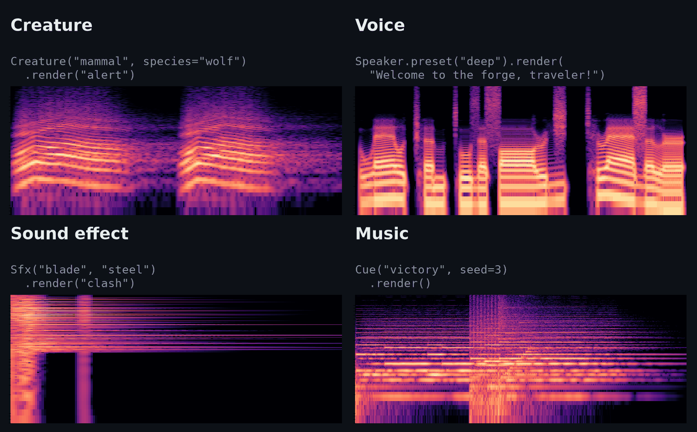
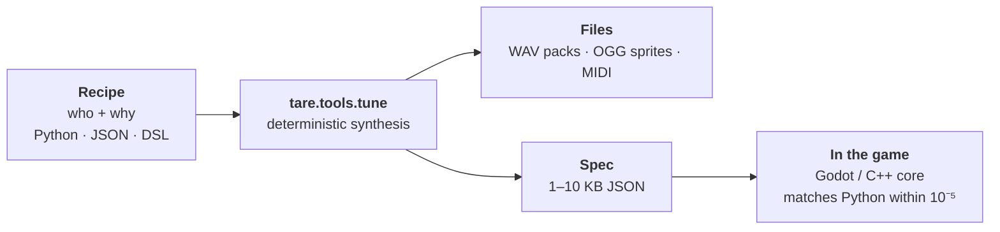

<div align="center">

# tare.tools.tune

**Game audio from code.** Creature cries, NPC voices, sound effects and music,<br>
synthesized on the spot: no recordings shipped, no AI at runtime, and the same recipe always gives the same sound.

[](https://github.com/augusto-scarvalho/tare.tools.tune/actions/workflows/tests.yml)
[](LICENSE)
[](pyproject.toml)


[](docs/guide.md#2-runtime-generate-inside-the-game)
[](SKILL.md)

**English** · [Português](README.pt-BR.md) · [Full guide](docs/guide.md) · [Docs](docs/README.md)



</div>

## Why

- 🧬 **Describe who and why, not waveforms.** A big, angry wolf attacking. A deep-voiced blacksmith greeting you. A steel sword clashing. The sound follows.
- 🎲 **Deterministic, never copy-pasted.** Same input, same sound. With the [tested numpy and scipy](constraints.txt), two different Intel machines on Windows gave bit-identical WAVs for all 960 test sounds. Windows and Linux matched on 954, and the other 6 differ in one sample by the smallest step. Each individual and each take varies a little, so repeats don't sound identical.
- 🪶 **Tiny.** Only numpy and scipy. A sound is a 1–10 KB JSON spec that your game can render on demand.
- 🗣️ **Speech in Brazilian Portuguese and English**, plus wordless barks (*hyah!*, *ugh*, *hm?*) in each character's own voice.
- 🎮 **Engine-ready.** WAV packs for any engine, OGG sprite banks for the web, MIDI, and a C++ renderer for Godot that matches Python to within 10⁻⁵, far below hearing.
- 🤖 **Built for agents too.** It ships as the [`tune-game-audio` skill](SKILL.md), and the review loop lets an agent read a sound as text.

> It began as a Pokémon Gen 1 cry synthesizer. That game made 151 cries from 38 templates plus pitch and duration, and the idea became the model for everything here: **species = genes, individual = small variations, take = a new performance**.

## Listen

25 sounds, each one rendered by [`examples/listen.py`](examples/listen.py): run it and you get the same WAVs: bit for bit on the same system, at most the smallest step apart across systems. **[▶ Listen in your browser](https://augusto-scarvalho.github.io/tare.tools.tune/)**, or download each one below as OGG (from the [listen-1 release](https://github.com/augusto-scarvalho/tare.tools.tune/releases/tag/listen-1)). The sounds, like the code, are under the Apache License 2.0.

- 🎼 **Music:** [victory][victory] (orchestral jingle) · [level up][levelup-16bit] (16-bit) · [town][town-16bit] (16-bit loop) · [tavern][tavern] · [battle][battle-8bit] (8-bit) · [reverie][reverie-16bit] (16-bit color harmony) · [festival][festival] (koto, shakuhachi, taiko) · [shrine][shrine] · [skirmish][skirmish] (tactics)
- 🗣️ **Portuguese:** [natural male voice][pt-natural-m] · [natural female voice][pt-natural-f] · [deep][pt-deep] · [child][pt-child] · [giant][pt-giant]
- 🗣️ **English:** [default][en-default] · [happy, then sad][en-emotions] · [robot][en-robot]
- 😤 **Barks:** [laugh][bark-laugh] · [kiai][bark-kiai] · [pain][bark-hurt] · [cheer][bark-cheer]
- ⚔️ **Effects:** [steel sword clash][sword-clash] · [fire spell][fire-spell] · [rain loop][rain-loop] (16 s, seamless)
- 🐦 **Creatures:** [a bird's alert call][bird-alert]

[victory]: https://github.com/augusto-scarvalho/tare.tools.tune/releases/download/listen-1/victory.ogg
[levelup-16bit]: https://github.com/augusto-scarvalho/tare.tools.tune/releases/download/listen-1/levelup-16bit.ogg
[town-16bit]: https://github.com/augusto-scarvalho/tare.tools.tune/releases/download/listen-1/town-16bit.ogg
[tavern]: https://github.com/augusto-scarvalho/tare.tools.tune/releases/download/listen-1/tavern.ogg
[battle-8bit]: https://github.com/augusto-scarvalho/tare.tools.tune/releases/download/listen-1/battle-8bit.ogg
[reverie-16bit]: https://github.com/augusto-scarvalho/tare.tools.tune/releases/download/listen-1/reverie-16bit.ogg
[festival]: https://github.com/augusto-scarvalho/tare.tools.tune/releases/download/listen-1/festival.ogg
[shrine]: https://github.com/augusto-scarvalho/tare.tools.tune/releases/download/listen-1/shrine.ogg
[skirmish]: https://github.com/augusto-scarvalho/tare.tools.tune/releases/download/listen-1/skirmish.ogg
[pt-natural-m]: https://github.com/augusto-scarvalho/tare.tools.tune/releases/download/listen-1/pt-natural-m.ogg
[pt-natural-f]: https://github.com/augusto-scarvalho/tare.tools.tune/releases/download/listen-1/pt-natural-f.ogg
[pt-deep]: https://github.com/augusto-scarvalho/tare.tools.tune/releases/download/listen-1/pt-deep.ogg
[pt-child]: https://github.com/augusto-scarvalho/tare.tools.tune/releases/download/listen-1/pt-child.ogg
[pt-giant]: https://github.com/augusto-scarvalho/tare.tools.tune/releases/download/listen-1/pt-giant.ogg
[en-default]: https://github.com/augusto-scarvalho/tare.tools.tune/releases/download/listen-1/en-default.ogg
[en-emotions]: https://github.com/augusto-scarvalho/tare.tools.tune/releases/download/listen-1/en-emotions.ogg
[en-robot]: https://github.com/augusto-scarvalho/tare.tools.tune/releases/download/listen-1/en-robot.ogg
[bark-laugh]: https://github.com/augusto-scarvalho/tare.tools.tune/releases/download/listen-1/bark-laugh.ogg
[bark-kiai]: https://github.com/augusto-scarvalho/tare.tools.tune/releases/download/listen-1/bark-kiai.ogg
[bark-hurt]: https://github.com/augusto-scarvalho/tare.tools.tune/releases/download/listen-1/bark-hurt.ogg
[bark-cheer]: https://github.com/augusto-scarvalho/tare.tools.tune/releases/download/listen-1/bark-cheer.ogg
[sword-clash]: https://github.com/augusto-scarvalho/tare.tools.tune/releases/download/listen-1/sword-clash.ogg
[fire-spell]: https://github.com/augusto-scarvalho/tare.tools.tune/releases/download/listen-1/fire-spell.ogg
[rain-loop]: https://github.com/augusto-scarvalho/tare.tools.tune/releases/download/listen-1/rain-loop.ogg
[bird-alert]: https://github.com/augusto-scarvalho/tare.tools.tune/releases/download/listen-1/bird-alert.ogg

## Quick start

```bash
pip install git+https://github.com/augusto-scarvalho/tare.tools.tune
```

A team or a build server? Install from a clone with `-c constraints.txt`: it pins the numpy and scipy we tested (Python 3.12+), so a new version can't change your renders. [Details →](docs/guide.md#installation)

```python
from tare.tools.tune import Creature, Sfx, write_wav
from tare.tools.tune.music import Cue
from tare.tools.tune.speech import Speaker

wolf = Creature("mammal", species="wolf", size=0.45, aggression=0.5)
write_wav("wolf_attack.wav", wolf.render("attack"), 48000)
dire_wolf = wolf.evolve(size=0.9)                    # same species, bigger
write_wav("dire_wolf_death.wav", dire_wolf.render("death", take=2), 48000)

smith = Speaker.preset("deep")
hello = smith.render("Welcome to the forge, traveler!", lang="en")
write_wav("smith.wav", hello, 48000)
write_wav("smith_laugh.wav", smith.emote("laugh"), 48000)   # a bark, same voice

sword = Sfx("blade", "steel", species="excalibur")
write_wav("clash.wav", sword.render("clash", take=3), 48000)
write_wav("victory.wav", Cue("victory", seed=3).render(), 48000)
```

Or from the command line:

```bash
tare.tools.tune sfx spell lightning --event impact -o lightning.wav
tare.tools.tune sfx ambience rain --event loop -o rain.wav   # 16 s, seamless
tare.tools.tune say "Hello there!" --lang en --voice npc:7 -o hello.wav
# a whole bestiary: 19 creatures × 5 calls × 3 takes, as WAV packs
tare.tools.tune bake examples/bestiary.json -o baked
```

## What it makes

| | Range | Highlights |
|---|---|---|
| 🐺 **[Creatures](docs/guide.md#archetypes)** | 10 archetypes × 5 calls | mammals, birds, insects, monsters, slimes, spirits, robots and more. A creature can `evolve()` and keep its species |
| 🗣️ **[Speech](docs/guide.md#human-speech)** | Portuguese and English | a formant voice or a natural voice bank; intonation from punctuation; emotions; a unique voice per NPC; gibberish and animalese |
| 😤 **[Barks](docs/guide.md#vocalizations-games-without-full-voice-acting)** | 20 vocalizations, 6 styles | attacks, pain, laughs, sighs and gasps in the character's voice, styled after action, anime, tactics and MMO games |
| ⚔️ **[Sound effects](docs/guide.md#sound-effects)** | 34 kinds | weapons, doors, chests, UI, status effects, spells, summons, footsteps, horses and seamless ambience loops; `era="16bit"`, knobs |
| 🎼 **[Music](docs/guide.md#music-and-composition)** | 43 instruments, 32 cues | jingles and loops in orchestral, 16-bit and 8-bit styles; a `Score` to lay out whole scenes |
| 👾 **[Gen 1 cries](docs/guide.md#generation-1-reproduction)** | a Game Boy cry engine | the `chip` archetype, plus a faithful reproduction of all 151 cries (bring your own data) |

## How it works



Struck bodies ring through modal synthesis, wind and fire are filtered noise, and crackles are clouds of tiny events. Voices are rebuilt by a small vocoder. Recordings and the offline teacher voice were only ever **measured**, and just the numbers ship: speech, barks and instruments alike. The [architecture](docs/architecture.md) explains each technique and the measurements behind it.

## Use it your way

- **Offline:** `bake` a bestiary into WAV packs with a manifest, then import them into Unity, Godot, Unreal, FMOD or Wwise. [How →](docs/guide.md#1-offline-generate-assets-for-any-engine)
- **Python games:** `VoiceBank` renders in threads, caches, and never plays the same take twice in a row. `AmbiencePlayer` keeps a place alive. [How →](docs/guide.md#2-runtime-generate-inside-the-game)
- **Godot:** the `tare_tune` extension turns small specs into sound inside the game. [How →](docs/guide.md#2-runtime-generate-inside-the-game)
- **With an AI agent:** in Claude Code, `/plugin install tare-tools-tune --marketplace augusto-scarvalho/tare.tools.tune`; for Codex and other agents, `npx skills add augusto-scarvalho/tare.tools.tune`. The agent then builds the skill's `.venv` and `tare.tools.tune doctor` checks it. [SKILL.md →](SKILL.md)

## Limits

- **It doesn't sing.** The music is instrumental (the choir sings vowels), and the speech is Brazilian Portuguese and English only.
- **The natural voices are Portuguese.** Two voice banks, a male and a female; English uses formant synthesis, which sounds more synthetic.
- **Realism varies from sound to sound.** Some effects and creatures still sound synthetic. The checks measure a sound but never judge its timbre: only listening tells.
- **Same sound, almost everywhere.** With the pinned numpy and scipy, Windows and Linux (x86 and ARM) match bit for bit on CI's 30 test sounds, and macOS is off by the smallest step in one of them. AMD processors are untested.
- **Godot renders part of the catalogue.** Its C++ core plays effects, creatures, natural speech and ambience loops from small specs; the `chip` archetype, barks and music still ship as WAVs from `bake`.

## Learn more

| Read | What's inside |
|---|---|
| 📖 [Full guide](docs/guide.md) | every archetype, voice, effect and cue, the knobs, engines, CLI and development |
| 🎛️ [Authoring](docs/authoring.md) | live studio, capture, inspection, MIDI and web sprites |
| 🔁 [Review loop](docs/dsl-review.md) | measured changes, checks and atomic edits, and the sound as text |
| 🧩 [Semantic DSL](docs/dsl.md) | reusable recipes, variants and guarded refinements (experimental) |
| 🏗️ [Architecture](docs/architecture.md) | how each sound is built, portability, and what listening tests found |
| 🗡️ [RPG sounds](docs/rpg-sounds.md) · [Tactical RPG sounds](docs/tactics-sounds.md) | coverage and status, sound by sound |
| 🗂️ [Documentation index](docs/README.md) | everything else, in English and Portuguese |
| 🤝 [Contributing](CONTRIBUTING.md) · [Changelog](CHANGELOG.md) · [Privacy](PRIVACY.md) | how to help, what changed, and what it runs, fetches and sends (nothing is sent) |

## Credits and license

The project stands on the Gen 1 cry synthesizer by [dotsarecool](http://dotsarecool.com/rgme/tech/gen1cries.html) and [ardean](https://github.com/ardean/pokemon-gen1-cry-synthesizer). It also builds on the [CMU Pronouncing Dictionary](https://github.com/cmusphinx/cmudict), [Kokoro-82M](https://huggingface.co/hexgrad/Kokoro-82M) as an offline teacher, the emotion measurements of [emoUERJ](https://doi.org/10.5281/zenodo.5427549), the [VSCO-2 CE](https://github.com/sgossner/VSCO-2-CE) orchestra, CC0 performers from OpenGameArt and Freesound, and the [WORLD](https://github.com/mmorise/World) vocoder design. Every source and its license is listed in the [full credits](docs/guide.md#credits).

[Apache License 2.0](LICENSE) © 2026 Augusto da Silva Carvalho.
