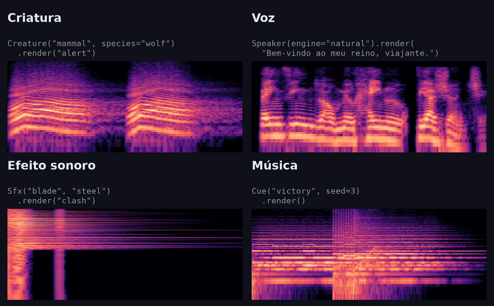
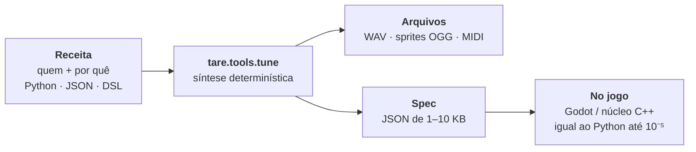

<div align="center">

# tare.tools.tune

**Áudio de jogo feito por código.** Vozes de criaturas, falas de NPC, efeitos sonoros e música,<br>
sintetizados na hora: nenhuma gravação no pacote, nenhuma IA rodando no jogo, e a mesma receita sempre dá o mesmo som.

[](https://github.com/augusto-scarvalho/tare.tools.tune/actions/workflows/tests.yml)
[](LICENSE)
[](pyproject.toml)


[](docs/pt-BR/guia.md#2-runtime-gerar-dentro-do-jogo)
[](SKILL.md)

[English](README.md) · **Português** · [Guia completo](docs/pt-BR/guia.md) · [Documentação](docs/README.md)



</div>

## Por quê

- 🧬 **Você descreve quem e por quê, não a forma de onda.** Um lobo grande e bravo atacando. Um ferreiro de voz grave dando boas-vindas. Uma espada de aço se chocando. O som vem daí.
- 🎲 **Determinístico, mas nunca copia e cola.** A mesma entrada dá o mesmo som. Com o [numpy e o scipy testados](constraints.txt), dois computadores Intel diferentes no Windows deram WAVs idênticos bit a bit nos 960 sons de teste. Entre Windows e Linux, 954 bateram, e nos outros 6 muda uma única amostra, no menor degrau possível. Cada indivíduo e cada take variam um pouco, então a repetição não soa idêntica.
- 🪶 **Pequeno.** Só numpy e scipy. Um som é uma spec JSON de 1 a 10 KB que o jogo transforma em áudio quando precisa.
- 🗣️ **Fala em português brasileiro e inglês**, e também interjeições sem palavras (*rá!*, *ugh*, *hm?*) na voz de cada personagem.
- 🎮 **Pronto para engine.** Pacotes de WAV para qualquer engine, sprites OGG para a web, MIDI e um renderizador C++ para o Godot que bate com o Python com diferença de no máximo 10⁻⁵, muito abaixo do que se ouve.
- 🤖 **Feito também para agentes.** Vem como a [skill `tune-game-audio`](SKILL.md), e o ciclo de revisão deixa o agente ler um som como texto.

> Tudo começou como um sintetizador dos gritos do Pokémon da 1ª geração. O jogo fazia 151 gritos a partir de 38 moldes, mais altura e duração, e essa ideia virou o modelo de todo o projeto: **espécie = genes, indivíduo = pequenas variações, take = uma nova interpretação**.

## Ouça

25 sons, cada um gerado por [`examples/listen.py`](examples/listen.py): rode e você recebe os mesmos WAVs, amostra por amostra. **[▶ Ouça no navegador](https://augusto-scarvalho.github.io/tare.tools.tune/)**, ou baixe cada um abaixo em OGG (do [release listen-1](https://github.com/augusto-scarvalho/tare.tools.tune/releases/tag/listen-1)). Os sons, como o código, estão sob a Licença Apache 2.0.

- 🎼 **Música:** [vitória][victory] (jingle orquestral) · [subiu de nível][levelup-16bit] (16 bits) · [cidade][town-16bit] (loop de 16 bits) · [taverna][tavern] · [batalha][battle-8bit] (8 bits) · [devaneio][reverie-16bit] (harmonia de cor, 16 bits) · [festival][festival] (koto, shakuhachi, taiko) · [santuário][shrine] · [escaramuça][skirmish] (tactics)
- 🗣️ **Português:** [voz natural masculina][pt-natural-m] · [voz natural feminina][pt-natural-f] · [grave][pt-deep] · [infantil][pt-child] · [gigante][pt-giant]
- 🗣️ **Inglês:** [padrão][en-default] · [feliz, depois triste][en-emotions] · [robô][en-robot]
- 😤 **Interjeições:** [risada][bark-laugh] · [kiai][bark-kiai] · [dor][bark-hurt] · [comemoração][bark-cheer]
- ⚔️ **Efeitos:** [espada de aço se chocando][sword-clash] · [magia de fogo][fire-spell] · [chuva em loop][rain-loop] (16 s, sem emenda)
- 🐦 **Criaturas:** [o alerta de um pássaro][bird-alert]

[victory]: https://github.com/augusto-scarvalho/tare.tools.tune/releases/download/listen-1/victory.ogg
[levelup-16bit]: https://github.com/augusto-scarvalho/tare.tools.tune/releases/download/listen-1/levelup-16bit.ogg
[town-16bit]: https://github.com/augusto-scarvalho/tare.tools.tune/releases/download/listen-1/town-16bit.ogg
[tavern]: https://github.com/augusto-scarvalho/tare.tools.tune/releases/download/listen-1/tavern.ogg
[battle-8bit]: https://github.com/augusto-scarvalho/tare.tools.tune/releases/download/listen-1/battle-8bit.ogg
[reverie-16bit]: https://github.com/augusto-scarvalho/tare.tools.tune/releases/download/listen-1/reverie-16bit.ogg
[festival]: https://github.com/augusto-scarvalho/tare.tools.tune/releases/download/listen-1/festival.ogg
[shrine]: https://github.com/augusto-scarvalho/tare.tools.tune/releases/download/listen-1/shrine.ogg
[skirmish]: https://github.com/augusto-scarvalho/tare.tools.tune/releases/download/listen-1/skirmish.ogg
[pt-natural-m]: https://github.com/augusto-scarvalho/tare.tools.tune/releases/download/listen-1/pt-natural-m.ogg
[pt-natural-f]: https://github.com/augusto-scarvalho/tare.tools.tune/releases/download/listen-1/pt-natural-f.ogg
[pt-deep]: https://github.com/augusto-scarvalho/tare.tools.tune/releases/download/listen-1/pt-deep.ogg
[pt-child]: https://github.com/augusto-scarvalho/tare.tools.tune/releases/download/listen-1/pt-child.ogg
[pt-giant]: https://github.com/augusto-scarvalho/tare.tools.tune/releases/download/listen-1/pt-giant.ogg
[en-default]: https://github.com/augusto-scarvalho/tare.tools.tune/releases/download/listen-1/en-default.ogg
[en-emotions]: https://github.com/augusto-scarvalho/tare.tools.tune/releases/download/listen-1/en-emotions.ogg
[en-robot]: https://github.com/augusto-scarvalho/tare.tools.tune/releases/download/listen-1/en-robot.ogg
[bark-laugh]: https://github.com/augusto-scarvalho/tare.tools.tune/releases/download/listen-1/bark-laugh.ogg
[bark-kiai]: https://github.com/augusto-scarvalho/tare.tools.tune/releases/download/listen-1/bark-kiai.ogg
[bark-hurt]: https://github.com/augusto-scarvalho/tare.tools.tune/releases/download/listen-1/bark-hurt.ogg
[bark-cheer]: https://github.com/augusto-scarvalho/tare.tools.tune/releases/download/listen-1/bark-cheer.ogg
[sword-clash]: https://github.com/augusto-scarvalho/tare.tools.tune/releases/download/listen-1/sword-clash.ogg
[fire-spell]: https://github.com/augusto-scarvalho/tare.tools.tune/releases/download/listen-1/fire-spell.ogg
[rain-loop]: https://github.com/augusto-scarvalho/tare.tools.tune/releases/download/listen-1/rain-loop.ogg
[bird-alert]: https://github.com/augusto-scarvalho/tare.tools.tune/releases/download/listen-1/bird-alert.ogg

## Começo rápido

```bash
pip install git+https://github.com/augusto-scarvalho/tare.tools.tune
```

Uma equipe ou um servidor de build? Instale a partir de um clone com `-c constraints.txt`: ele fixa o numpy e o scipy que testamos (Python 3.12+), e assim uma versão nova não muda os seus sons. [Detalhes →](docs/pt-BR/guia.md#instalação)

```python
from tare.tools.tune import Creature, Sfx, write_wav
from tare.tools.tune.music import Cue
from tare.tools.tune.speech import Speaker

lobo = Creature("mammal", species="wolf", size=0.45, aggression=0.5)
write_wav("lobo_ataque.wav", lobo.render("attack"), 48000)
gigante = lobo.evolve(size=0.9)                      # mesma espécie, maior
write_wav("lobo_gigante_morte.wav", gigante.render("death", take=2), 48000)

ferreiro = Speaker.preset("deep")
fala = ferreiro.render("Bem-vindo à forja, viajante!", lang="pt")
write_wav("ferreiro.wav", fala, 48000)
write_wav("ferreiro_risada.wav", ferreiro.emote("laugh"), 48000)   # mesma voz

espada = Sfx("blade", "steel", species="excalibur")
write_wav("choque.wav", espada.render("clash", take=3), 48000)
write_wav("vitoria.wav", Cue("victory", seed=3).render(), 48000)
```

Ou pela linha de comando:

```bash
tare.tools.tune sfx spell lightning --event impact -o raio.wav
tare.tools.tune sfx ambience rain --event loop -o chuva.wav   # 16 s, sem emenda
tare.tools.tune say "Olá, viajante!" --voice npc:7 -o ola.wav
# um bestiário inteiro: 19 criaturas × 5 chamados × 3 takes, em WAV
tare.tools.tune bake examples/bestiary.json -o baked
```

## O que ele faz

| | Alcance | Destaques |
|---|---|---|
| 🐺 **[Criaturas](docs/pt-BR/guia.md#arquétipos)** | 10 arquétipos × 5 chamados | mamíferos, aves, insetos, monstros, slimes, espíritos, robôs e mais. Uma criatura pode `evolve()` sem perder a espécie |
| 🗣️ **[Fala](docs/pt-BR/guia.md#fala-humana)** | português e inglês | voz de formantes ou banco de voz natural; entonação pela pontuação; emoções; uma voz única por NPC; língua inventada e animalese |
| 😤 **[Interjeições](docs/pt-BR/guia.md#interjeições-jogos-sem-dublagem-completa)** | 20 tipos, 6 estilos | golpes, dor, risadas, suspiros e sustos na voz do personagem, no estilo de jogos de ação, anime, tactics e MMO |
| ⚔️ **[Efeitos sonoros](docs/pt-BR/guia.md#efeitos-sonoros)** | 34 tipos | armas, portas, baús, interface, status, magias, invocações, passos, cavalos e ambientes em loop sem emenda; `era="16bit"`, botões de ajuste |
| 🎼 **[Música](docs/pt-BR/guia.md#música-e-composição)** | 43 instrumentos, 32 músicas | vinhetas e loops nos estilos orquestral, 16 bits e 8 bits; um `Score` para montar cenas inteiras |
| 👾 **[Gritos da 1ª geração](docs/pt-BR/guia.md#reprodução-da-1ª-geração)** | o motor de gritos do Game Boy | o arquétipo `chip`, e a reprodução fiel dos 151 gritos (com os seus próprios dados) |

## Como funciona



Corpos que vibram (metal, madeira, sinos) soam por síntese modal, vento e fogo são ruído filtrado, e estalos são nuvens de eventos minúsculos. As vozes são refeitas por um vocoder pequeno. As gravações e a voz-professora offline foram só **medidas**, e só os números vão no pacote, tanto da fala quanto das interjeições e dos instrumentos. A [arquitetura](docs/pt-BR/arquitetura.md) explica cada técnica e as medições por trás dela.

## Do seu jeito

- **Offline:** o `bake` transforma um bestiário em pacotes de WAV com manifesto, que você importa na Unity, no Godot, na Unreal, no FMOD ou no Wwise. [Como →](docs/pt-BR/guia.md#1-offline-gerar-assets-para-qualquer-engine)
- **Jogos em Python:** o `VoiceBank` renderiza em threads, guarda em cache e nunca toca o mesmo take duas vezes seguidas. O `AmbiencePlayer` mantém um lugar vivo. [Como →](docs/pt-BR/guia.md#2-runtime-gerar-dentro-do-jogo)
- **Godot:** a extensão `tare_tune` transforma specs pequenas em som dentro do jogo. [Como →](docs/pt-BR/guia.md#2-runtime-gerar-dentro-do-jogo)
- **Com um agente de IA:** ligue o repositório como a skill `tune-game-audio` no Claude Code ou no Codex. [SKILL.md →](SKILL.md)

## Para saber mais

| Leia | O que tem lá |
|---|---|
| 📖 [Guia completo](docs/pt-BR/guia.md) | todos os arquétipos, vozes, efeitos e músicas, os botões de ajuste, os motores, a linha de comando e o desenvolvimento |
| 🎛️ [Autoria](docs/pt-BR/autoria.md) | estúdio ao vivo, captura, inspeção, MIDI e sprites para a web |
| 🔁 [Revisar e editar](docs/pt-BR/revisao-dsl.md) | mudanças medidas, verificações, edições atômicas e o som como texto |
| 🧩 [DSL semântica](docs/pt-BR/dsl.md) | receitas reutilizáveis, variantes e refinamentos com guarda (experimental) |
| 🏗️ [Arquitetura](docs/pt-BR/arquitetura.md) | como cada som é feito, portabilidade e o que os testes de escuta mostraram |
| 🗡️ [Sons de RPG](docs/pt-BR/sons-rpg.md) · [Sons de tactics RPG](docs/pt-BR/sons-tactics.md) | cobertura e status, som por som |
| 🗂️ [Índice da documentação](docs/README.md) | todo o resto, em inglês e português |

## Créditos e licença

O projeto parte do sintetizador de gritos da 1ª geração de [dotsarecool](http://dotsarecool.com/rgme/tech/gen1cries.html) e [ardean](https://github.com/ardean/pokemon-gen1-cry-synthesizer). Também se apoia no [CMU Pronouncing Dictionary](https://github.com/cmusphinx/cmudict), no [Kokoro-82M](https://huggingface.co/hexgrad/Kokoro-82M) como professor offline, nas medições de emoção do [emoUERJ](https://doi.org/10.5281/zenodo.5427549), na orquestra [VSCO-2 CE](https://github.com/sgossner/VSCO-2-CE), em intérpretes CC0 do OpenGameArt e do Freesound e no desenho do vocoder [WORLD](https://github.com/mmorise/World). Todas as fontes e licenças estão nos [créditos completos](docs/pt-BR/guia.md#créditos).

[Licença Apache 2.0](LICENSE) © 2026 Augusto da Silva Carvalho.
